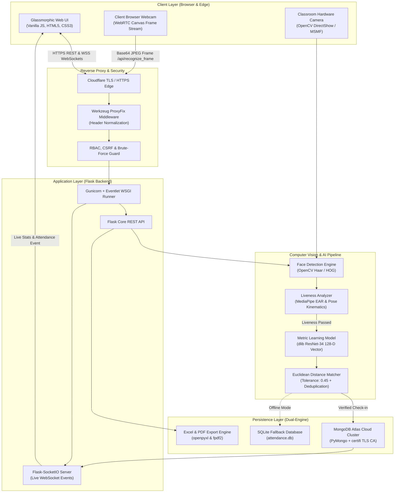
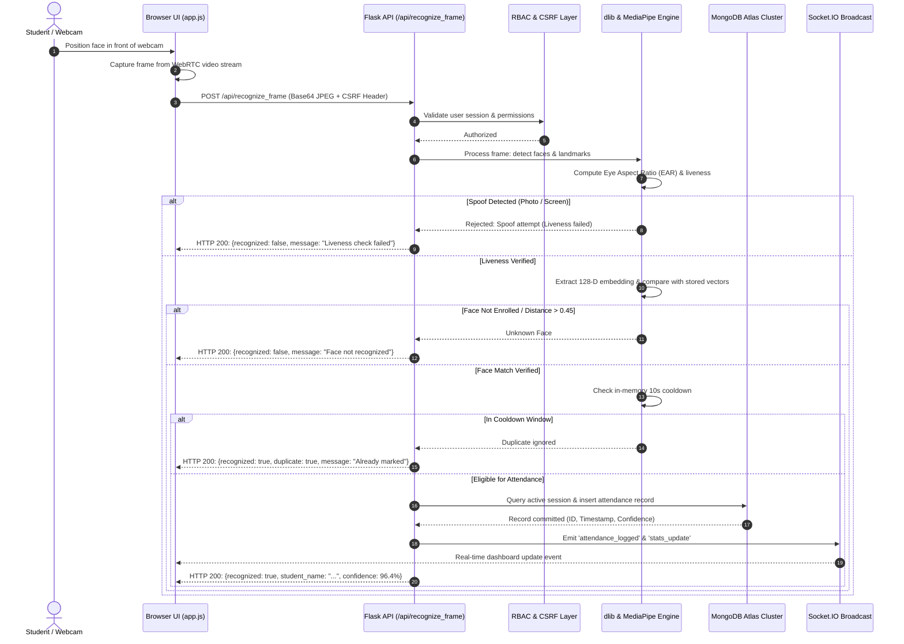

# 👁️ Drishti AI — Smart Campus Attendance Platform

[](https://drishti-ai-attendance.onrender.com)
[](https://www.mongodb.com/atlas)
[](https://github.com/ageitgey/face_recognition)
[](#-testing--automated-verification)
[](#-academic-acknowledgment)

> **Drishti AI** is an enterprise-grade, contactless facial recognition attendance and real-time campus monitoring platform developed as a **B.Tech Minor Project**. Built with Python, Flask, dlib 128-D deep metric learning, MongoDB Atlas cloud clustering, WebSocket synchronization, and a modern glassmorphic web interface.

---

## 🌐 Live Deployment & Links

| Resource | URL |
| :--- | :--- |
| **Production Application** | [https://drishti-ai-attendance.onrender.com](https://drishti-ai-attendance.onrender.com/) |
| **GitHub Repository** | [https://github.com/Atharvagig/drishti-ai-attendance](https://github.com/Atharvagig/drishti-ai-attendance) |
| **Project Submission Package** | [`submission/`](file:///d:/project/submission) |

---

## 📌 Problem Statement & Objectives

### Problem Statement
Traditional academic attendance mechanisms suffer from severe structural drawbacks:
1. **Proxy Attendance ("Buddy Punching")**: Students marking roll calls or scanning static QR codes for absent peers.
2. **Instructional Time Wastage**: Manual roll calls consume 10–15% of every lecture hour in large classrooms.
3. **Transcription & Administrative Overhead**: Manual paper registers lead to transcription errors, delayed reporting, and difficulty in aggregating semester-wide eligibility metrics.
4. **Lack of Verifiable Auditability**: Absence of real-time timestamps, biometric confidence scores, or tamper-evident audit trails.

### Project Objectives
- **Zero-Touch Biometric Verification**: Automate classroom check-ins via real-time 128-dimensional facial feature vector embeddings.
- **Anti-Spoofing Defense**: Integrate computer vision liveness checks (Eye Aspect Ratio and head pose kinematics) to defeat photo and screen playback attacks.
- **Resilient Dual-Engine Persistence**: Utilize MongoDB Atlas cloud clustering for production durability while retaining an automatic SQLite fallback for offline lab setups.
- **Granular Role-Based Access Control (RBAC)**: Enforce security isolation across Super Admin, Department Head, Faculty, and Student personas.
- **Dual Camera Architecture**: Support both edge hardware cameras (DirectShow/MSMF) and client-side browser webcams via WebRTC frame streaming.
- **Immediate Auditability & Export**: Provide real-time WebSocket dashboard sync and instantaneous export to styled Excel (`.xlsx`), CSV, and PDF reports.

---

## ✨ Implemented Core Features

- **⚡ High-Precision Face Recognition**: Powered by dlib's state-of-the-art ResNet-34 metric learning model (`face_recognition`), generating 128-dimensional Euclidean feature vectors with a calibrated tolerance of `0.45`.
- **🛡️ Liveness Detection & Anti-Spoofing**: MediaPipe Face Mesh landmark tracking monitors Eye Aspect Ratio (EAR) for blink dynamics and facial landmark geometry to reject static photo or mobile screen spoofing attempts.
- **☁️ MongoDB Atlas Cloud Architecture**: Production-grade document storage connecting via `certifi` CA verification, connection pooling, compound unique indexing, and sequence counters.
- **🔄 Dual-Engine Storage Fallback**: Automatic detection of `MONGODB_URI`; runs on MongoDB Atlas in production and smoothly switches to local SQLite (`backend/data/attendance.db`) for offline development.
- **🚫 3-Tier Duplicate Attendance Prevention**:
  1. *In-Memory Cooldown*: 10-second sliding window per student in the active camera stream.
  2. *Session-Level Query Validation*: Verification against existing attendance records for the active lecture session.
  3. *Database Compound Unique Constraints*: Database-level constraint on `(student_id, session_id)` ensuring duplicate marks are structurally impossible.
- **📊 Real-Time WebSocket Synchronization**: Flask-SocketIO (Eventlet async worker) broadcasts live attendance marks, camera heartbeats, and analytical counters directly to connected client dashboards without page reloads.
- **🌐 Dual-Mode Camera Tracking**:
  - *Browser WebRTC Mode*: Client webcam captures video frames and transmits Base64 JPEG payloads to `/api/recognize_frame`.
  - *DirectShow Hardware Mode*: Native OpenCV video capture for classroom-mounted USB and RTSP webcams.
- **🔐 Enterprise RBAC Security**:
  - 4 distinct hierarchical roles: `super_admin`, `department_head`, `faculty`, and `student`.
  - Passwords hashed using `bcrypt` with salted work factors.
  - Brute-force protection: Automatic account lock after 5 consecutive failed login attempts.
  - CSRF Token Validation (`_csrf_token` session cookie + `X-CSRFToken` request header on mutating calls).
  - Secure Session Cookies (`HttpOnly=True`, `SameSite=Lax`, `Secure=True` under HTTPS).
- **📤 Comprehensive Reporting**: Dynamic generation of styled Excel spreadsheets (via `openpyxl`), standardized CSV logs, and printable PDF attendance summaries (via `fpdf2`).

---

## 🏗️ System Architecture & Workflow

### High-Level System Architecture



### Attendance Verification Lifecycle



---

## 🛠️ Technology Stack

| Domain | Technology | Version | Purpose |
| :--- | :--- | :--- | :--- |
| **Backend Framework** | Python | 3.11 / 3.14 | Core server runtime and computation environment |
| | Flask | 3.0.0 | REST API routing, session management, and template rendering |
| | Flask-SocketIO | 5.3.6 | Bidirectional low-latency WebSocket communication |
| | Gunicorn | 21.2.0 | Production-grade WSGI HTTP server |
| | Eventlet | >= 0.33.3 | Asynchronous I/O worker for concurrent WebSocket connections |
| **Computer Vision & AI** | dlib (`dlib-bin`) | 20.0.0 | C++ machine learning library and 128-D ResNet face encoder |
| | face_recognition | 1.3.0 | High-level facial feature extraction and Euclidean distance matching |
| | OpenCV Headless | >= 4.8.0 | Frame manipulation, Haar cascade face localization, and image processing |
| | MediaPipe | Latest | Face Mesh landmark topology for EAR blink dynamics & head pose tracking |
| **Databases & Storage** | MongoDB Atlas | Cluster M0 | Primary cloud document persistence with TLS encryption |
| | PyMongo | >= 4.6.0 | Python driver for MongoDB with `certifi` CA certificate bundle |
| | SQLite 3 | Embedded | Local development and offline standalone fallback engine |
| | openpyxl & pandas | 3.1.2 / >= 2.0 | Spreadsheet automation, custom formatting, and analytics aggregation |
| | fpdf2 | 2.7.5 | Vectorized PDF attendance report generation |
| **Security & Auth** | bcrypt | 4.0.1 | Salted cryptographic password hashing |
| | Werkzeug ProxyFix | Built-in | Reverse-proxy header normalization (SSL termination on Render) |
| **Frontend** | Vanilla JavaScript | ES6+ | SPA client logic, WebRTC camera streaming, and dynamic DOM manipulation |
| | Glassmorphic CSS | Vanilla CSS3 | Dark-theme user interface with frosted glass effects and responsive flexbox |
| **DevOps & Hosting** | Docker | Multi-Stage | Debian-slim containerization ensuring reproducible runtime dependencies |
| | Render Web Services | Cloud PaaS | Continuous Docker deployment and TLS termination |
| **Quality Assurance** | Python unittest | Built-in | Automated test suite (29 test cases across 5 test suites) |
| | mongomock | >= 4.1.2 | In-memory MongoDB mock for isolated, reproducible testing |

---

## 💻 Local Installation & Setup (Windows)

### 1. Prerequisites
- **Operating System**: Windows 10 or Windows 11 (64-bit)
- **Python**: Python 3.10, 3.11, or 3.14
- **Webcam**: Integrated laptop camera or external USB webcam
- **Git**: Installed and accessible in PowerShell/CMD

### 2. Clone the Repository
```powershell
git clone https://github.com/Atharvagig/drishti-ai-attendance.git
cd drishti-ai-attendance
```

### 3. Create & Activate Virtual Environment
```powershell
# Create a virtual environment named venv
python -m venv venv

# Activate the virtual environment
.\venv\Scripts\activate
```

### 4. Install Dependencies
```powershell
# Upgrade pip and install pinned dependencies
python -m pip install --upgrade pip setuptools wheel
pip install -r requirements.txt
```

> **Note on dlib**: On Windows, compiling dlib from source requires CMake and Visual Studio C++ Build Tools. A precompiled wheel (`dlib-20.0.99-cp314-cp314-win_amd64.whl`) or `pip install dlib-bin` can be used to bypass compilation.

### 5. Configure Environment Variables
Copy the template configuration file:
```powershell
copy .env.example .env
```
Open `.env` in your text editor and configure your variables (see [Environment Configuration](#-environment-variable-configuration) below).

### 6. Initialize Database & Seed Demo Data
To immediately populate the system with academic departments, subjects, classrooms, faculty, and sample students:
```powershell
python backend/seed_demo.py
```

### 7. Run the Application

#### Option A: One-Click Launcher (Recommended for Windows)
Simply double-click [`start.bat`](file:///d:/project/start.bat) in the project root directory. It automatically locates the virtual environment, verifies native dependencies, and launches the server.

#### Option B: Terminal Command
```powershell
python run.py
```

The application will bind to `http://127.0.0.1:5000`.

---

## ⚙️ Environment Variable Configuration

All application configuration is driven through environment variables. Safe defaults are provided in [`.env.example`](file:///d:/project/.env.example).

| Variable | Required in Prod | Default | Description |
| :--- | :---: | :--- | :--- |
| `DB_BACKEND` | Optional | `mongodb` | Database engine: `mongodb` or `sqlite`. Auto-detected if `MONGODB_URI` is present. |
| `MONGODB_URI` | **Yes** (Cloud) | *None* | Connection URI: `mongodb+srv://<user>:<pwd>@<cluster>.mongodb.net/?retryWrites=true&w=majority` |
| `DATABASE_NAME` | No | `drishti_attendance` | Target database name inside MongoDB Atlas cluster. |
| `DB_PATH` | No | `data/attendance.db` | Relative path to local SQLite database when offline. |
| `FLASK_ENV` | No | `development` | Environment mode (`development` or `production`). |
| `FLASK_PORT` / `PORT` | No | `5000` | Port for the HTTP server to listen on. |
| `SECRET_KEY` | **Yes** (Prod) | *Default key* | Cryptographic key used to sign session cookies. |
| `ADMIN_PASSWORD` | **Yes** (Prod) | *None* | Super Admin password. In production, >= 8 chars is **strictly enforced**. |
| `SESSION_TIMEOUT_MINUTES` | No | `60` | Web session idle lifetime before requiring re-authentication. |
| `SESSION_COOKIE_SECURE` | No | `false` | When `true`, enforces `Secure` attribute on cookies (auto-true on Render). |
| `MATCH_TOLERANCE` | No | `0.45` | Facial distance threshold. Lower is stricter (0.40 = strict, 0.45 = balanced). |
| `COOLDOWN_SECONDS` | No | `10` | Minimum seconds between duplicate attendance marks for a student. |
| `HEADLESS` | No | `false` | Suppresses local OpenCV GUI windows (recommended for Docker/cloud). |
| `DEMO_MODE` | No | `false` | Enables `/api/demo/seed` for generating simulated viva demonstration records. |

> [!WARNING]
> Never commit `.env` or production credentials to Git. The `.gitignore` file is configured to strictly exclude all `.env*` files except `.env.example`.

---

## 🗄️ MongoDB Atlas Cloud Setup & Migration

### 1. Setting up MongoDB Atlas Cluster
1. Create a free account at [MongoDB Atlas](https://www.mongodb.com/atlas).
2. Deploy a free **M0 Sandbox** cluster (AWS or GCP region).
3. Under **Security > Database Access**, create a database user (e.g., `drishti_user`) with read and write privileges.
4. Under **Security > Network Access**, add IP address `0.0.0.0/0` (Allow Access from Anywhere) to permit connections from Render's cloud servers.
5. Under **Deployment > Database**, click **Connect > Drivers > Python** and copy the connection string.

### 2. Validating & Migrating Data
Drishti AI includes a dual-engine migration utility ([`backend/migrate_to_mongo.py`](file:///d:/project/backend/migrate_to_mongo.py)):

```powershell
# 1. Perform a dry-run migration (validates connection, counts, and schemas without writing)
python backend/migrate_to_mongo.py --dry-run --uri "mongodb+srv://<user>:<password>@cluster.mongodb.net/?retryWrites=true&w=majority"

# 2. Execute full migration from SQLite to MongoDB Atlas
python backend/migrate_to_mongo.py --uri "mongodb+srv://<user>:<password>@cluster.mongodb.net/?retryWrites=true&w=majority"
```

The migration script:
- Verifies connectivity using TLS CA certificates via `certifi`.
- Migrates students, 128-D face embeddings, academic sessions, attendance records, audit logs, and users.
- Creates compound unique indexes on `attendance` (`student_id` + `session_id`).
- Creates unique indexes on `students` (`student_id`) and `users` (`username`).

---

## 🧪 Testing & Automated Verification

Drishti AI includes a comprehensive automated test suite of **29 test cases** covering authentication, facial recognition workflows, database operations, RBAC isolation, and security controls.

### Running the Test Suite
```powershell
# Run all tests using Python unittest
python -m unittest discover -s tests -p "test_*.py" -v
```

### Verified Test Suites

| Suite | File | Tests | Coverage Scope |
| :--- | :--- | :---: | :--- |
| **Authentication Flow** | [`tests/test_auth_flow.py`](file:///d:/project/tests/test_auth_flow.py) | 5 | Login, logout, session expiration, unauthorized redirect to `/login?next=...`, and `/auth/me` user endpoint. |
| **Camera & Recognition** | [`tests/test_browser_camera_workflow.py`](file:///d:/project/tests/test_browser_camera_workflow.py) | 2 | End-to-end WebRTC frame submission, dlib 128-D vector matching, and 10s cooldown duplicate rejection. |
| **MongoDB Atlas Engine** | [`tests/test_database_mongo.py`](file:///d:/project/tests/test_database_mongo.py) | 8 | PyMongo CRUD operations, index creation, student enrollment, embedding storage, duplicate constraints, and cascade deletion. |
| **RBAC Security Matrix** | [`tests/test_rbac.py`](file:///d:/project/tests/test_rbac.py) | 4 | Role hierarchies (`super_admin`, `department_head`, `faculty`, `student`) and data access scoping. |
| **Security & Controls** | [`tests/test_security_and_auth.py`](file:///d:/project/tests/test_security_and_auth.py) | 8 | Route protection, CSRF token validation on mutating endpoints, privilege escalation prevention, 5-attempt brute-force lockout, and production password enforcement. |
| **Total** | | **29** | **100% Pass Rate (All 29 Passed)** |

---

## 🐳 Docker & Render Cloud Deployment

The application is deployed to production using a lightweight, multi-stage Docker configuration optimized for cloud container environments.

### Why Multi-Stage Docker Build?
Standard `dlib` compilation requires compiling C++ libraries with `dlib` and `CMake`, which consumes over 8GB of RAM and causes memory crashes on free-tier cloud platforms. Drishti AI's [`Dockerfile`](file:///d:/project/Dockerfile) solves this via:
1. **Prebuilt Binary Wheel**: Uses `dlib-bin` to eliminate runtime C++ compilation.
2. **Build Isolation**: A `builder` stage builds dependencies with `CMAKE_BUILD_PARALLEL_LEVEL=1`.
3. **Slim Production Runner**: The final stage copies precompiled site-packages into a clean `python:3.11-slim` container containing only runtime shared libraries (`libopenblas0`, `liblapack3`, `libgl1`, `ca-certificates`).
4. **Memory Footprint**: Keeps build memory well under 500MB and runtime container memory around 280MB.

### Building & Running with Docker Locally

```bash
# Build the Docker image
docker build -t drishti-ai-attendance .

# Run the container locally
docker run -p 5000:5000 --env-file .env drishti-ai-attendance
```

### Render Deployment Configuration
The repository includes a declarative [`render.yaml`](file:///d:/project/render.yaml) blueprint:

```yaml
services:
  - type: web
    name: drishti-ai-attendance
    runtime: docker
    plan: free
    dockerfilePath: ./Dockerfile
    startCommand: gunicorn --worker-class eventlet -w 1 --bind 0.0.0.0:$PORT --chdir backend app_flask:app
    healthCheckPath: /api/health
    envVars:
      - key: FLASK_ENV
        value: production
      - key: DB_BACKEND
        value: mongodb
      - key: DATABASE_NAME
        value: drishti_attendance
      - key: MONGODB_URI
        sync: false
      - key: ADMIN_PASSWORD
        sync: false
      - key: SECRET_KEY
        generateValue: true
```

---

## 📡 API Endpoint Reference

All mutating endpoints (`POST`, `PUT`, `DELETE`) require a valid session cookie and a matching `X-CSRFToken` header.

### 1. Authentication & Session Management
| Method | Endpoint | Access | Description |
| :--- | :--- | :--- | :--- |
| `GET` | `/login` | Public | Serves the login page. |
| `POST` | `/auth/login` | Public | Authenticates credentials; returns user object and session. |
| `POST` | `/auth/logout` | Authenticated | Terminates session and clears cookies. |
| `GET` | `/auth/me` | Authenticated | Returns current authenticated user profile and permissions. |
| `POST` | `/auth/change-password` | Authenticated | Updates the password of the currently authenticated user. |

### 2. User & Account Management
| Method | Endpoint | Access | Description |
| :--- | :--- | :--- | :--- |
| `GET` | `/api/users` | Admin | Lists all user accounts with role and status. |
| `POST` | `/api/users` | Admin | Creates a new user account with assigned role. |
| `GET` | `/api/users/<user_id>` | Admin | Retrieves specific user profile details. |
| `PUT` | `/api/users/<user_id>` | Admin | Updates user information and assigned role. |
| `POST` | `/api/users/<user_id>/disable` | Admin | Disables account access. |
| `POST` | `/api/users/<user_id>/enable` | Admin | Re-enables a disabled account. |
| `POST` | `/api/users/<user_id>/unlock` | Admin | Clears failed login counter and unlocks an account. |
| `POST` | `/api/users/<user_id>/reset-password` | Admin | Resets a user's password to a temporary credential. |

### 3. Face Recognition & Attendance
| Method | Endpoint | Access | Description |
| :--- | :--- | :--- | :--- |
| `POST` | `/api/recognize_frame` | Authenticated | Receives Base64 webcam frame; returns recognition result. |
| `GET` | `/api/attendance` | Authenticated | Retrieves attendance records filtered by date/session/dept. |
| `DELETE` | `/api/attendance/<record_id>` | Admin / Faculty | Deletes an attendance log entry. |
| `POST` | `/api/attendance/<record_id>/override` | Admin / Faculty | Manually changes attendance status (e.g. Present/Late). |

### 4. Academic Sessions
| Method | Endpoint | Access | Description |
| :--- | :--- | :--- | :--- |
| `GET` | `/api/sessions` | Authenticated | Lists all academic lecture sessions. |
| `POST` | `/api/sessions` | Admin / Faculty | Creates a new lecture session. |
| `GET` | `/api/sessions/<session_id>` | Authenticated | Retrieves session details and student list. |
| `POST` | `/api/sessions/<session_id>/start` | Admin / Faculty | Starts the session camera tracking. |
| `POST` | `/api/sessions/<session_id>/stop` | Admin / Faculty | Stops the active session. |
| `POST` | `/api/sessions/<session_id>/lock` | Admin / Faculty | Locks session to prevent any further attendance marks. |
| `GET` | `/api/sessions/<session_id>/attendance` | Authenticated | Returns logs specific to the session. |

### 5. Student Enrollment & Analytics
| Method | Endpoint | Access | Description |
| :--- | :--- | :--- | :--- |
| `GET` | `/api/students` | Authenticated | Lists enrolled students (scoped by role/department). |
| `POST` | `/api/register` | Admin / Faculty | Enrolls new student with 128-D face embeddings. |
| `GET` | `/api/students/<student_id>/attendance` | Authenticated | Returns attendance history for a single student. |
| `GET` | `/api/students/<student_id>/analytics` | Authenticated | Returns attendance heatmap, percentage, and trends. |
| `POST` | `/api/students/delete` | Admin | Permanently deletes student profile and face embeddings. |

### 6. Analytics & System Health
| Method | Endpoint | Access | Description |
| :--- | :--- | :--- | :--- |
| `GET` | `/api/health` / `/health` | Public | Returns database engine status, face cache, and uptime. |
| `GET` | `/api/stats` | Authenticated | Dashboard counters (present, absent, late, total). |
| `GET` | `/api/analytics/overview` | Authenticated | High-level attendance percentages across departments. |
| `GET` | `/api/analytics/trends` | Authenticated | 7-day attendance distribution trends. |
| `GET` | `/api/analytics/heatmap` | Authenticated | Monthly calendar attendance density matrix. |
| `GET` | `/api/audit-logs` | Admin | System audit trail of administrative actions. |
| `GET` | `/api/anomalies` | Admin | Log of flagged security anomalies (spoofs, duplicates). |

### 7. Export Engine
| Method | Endpoint | Access | Description |
| :--- | :--- | :--- | :--- |
| `GET` | `/api/export` | Authenticated | Generates master/daily Excel spreadsheet (`.xlsx`). |
| `GET` | `/api/export/csv` | Authenticated | Streams standardized comma-separated records (`.csv`). |
| `GET` | `/api/export/pdf` | Authenticated | Generates formatted PDF attendance report (`.pdf`). |

---

## 🔒 Security Architecture & Known Limitations

### Security Features Implemented
- **Salted Password Hashing**: Passwords stored as `bcrypt` hashes with adaptive work factors.
- **Brute-Force Attack Prevention**: Accounts automatically lock after 5 consecutive failed login attempts; unlocked via admin portal or administrative API.
- **CSRF Defense**: Mutating actions require CSRF tokens stored in sessions and validated via request headers.
- **Reverse-Proxy Header Integrity**: Configured with `werkzeug.middleware.proxy_fix.ProxyFix` to correctly parse `X-Forwarded-Proto` and enforce HTTPS security attributes over Render's Cloudflare load balancer.
- **TLS Certificate Validation**: Cloud connections to MongoDB Atlas use Python `certifi` bundles to guarantee strict TLS 1.2+ validation.
- **Role Isolation**: Faculty accounts are scoped to their assigned academic sessions; Student accounts are restricted exclusively to their personal records.

### Known Limitations
1. **Render Free-Tier Spin-Down**: Render's free tier suspends idle web services after 15 minutes of inactivity. The initial request ("cold start") may take 45–60 seconds while the container initializes.
2. **Lighting Sensitivity**: Like all metric learning models based on 2D visual feature extractors, severe backlighting or extremely dark environments can reduce facial embedding match confidence.
3. **Single Local Camera Lock**: When running hardware DirectShow cameras on Windows, a webcam cannot be simultaneously accessed by two separate desktop processes. Use Browser Camera mode for multi-tab testing.

---

## 🎓 Academic Submission Package (`submission/`)

The repository includes a comprehensive set of academic project deliverables prepared for B.Tech project evaluations and viva examinations:

- 📊 **[`submission/Drishti_AI_10_Slide_Presentation.pptx`](file:///d:/project/submission/Drishti_AI_10_Slide_Presentation.pptx)**: Professional 10-slide PowerPoint deck styled with dark slate aesthetics, metric callouts, and clean architecture overviews.
- 📑 **[`submission/DRISHTI_AI_10_SLIDE_PRESENTATION_TRANSCRIPT.md`](file:///d:/project/submission/DRISHTI_AI_10_SLIDE_PRESENTATION_TRANSCRIPT.md)**: Word-for-word oral presentation transcript covering slide narrative, technical defense points, and viva cues.
- 🎯 **[`submission/VIVA_PREPARATION_GUIDE.md`](file:///d:/project/submission/VIVA_PREPARATION_GUIDE.md)**: 20 comprehensive technical questions and answers covering Euclidean distance, dlib ResNet, MediaPipe EAR, MongoDB sharding, and CSRF protection.
- 🧪 **[`submission/TEST_RESULTS_REPORT.md`](file:///d:/project/submission/TEST_RESULTS_REPORT.md)**: Complete QA report documenting automated test results, latency benchmarks, and edge-case validations.
- 📹 **[`submission/DEMO_RECORDING_SCRIPT.md`](file:///d:/project/submission/DEMO_RECORDING_SCRIPT.md)**: Timed demonstration video script for presenting enrollment, live recognition, and reporting.
- ☁️ **[`submission/DEPLOYMENT_GUIDE_MONGODB_ATLAS.md`](file:///d:/project/submission/DEPLOYMENT_GUIDE_MONGODB_ATLAS.md)**: Step-by-step Atlas setup, network rules, and cloud migration walkthrough.
- ✅ **[`submission/FINAL_SUBMISSION_CHECKLIST.md`](file:///d:/project/submission/FINAL_SUBMISSION_CHECKLIST.md)**: Pre-viva verification checklist for evaluating faculty.

---

## 🧑‍💻 Academic Acknowledgment

This project is submitted in partial fulfillment of the requirements for the degree of **Bachelor of Technology (B.Tech)** in Computer Science & Engineering.

- **Developer**: Atharva Tripathi
- **Project**: Drishti AI — Smart Attendance System
- **Repository**: [https://github.com/Atharvagig/drishti-ai-attendance](https://github.com/Atharvagig/drishti-ai-attendance)
- **Production URL**: [https://drishti-ai-attendance.onrender.com](https://drishti-ai-attendance.onrender.com)
